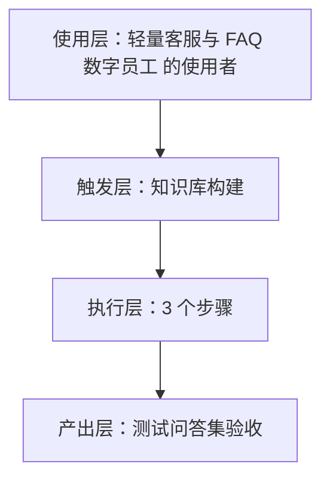
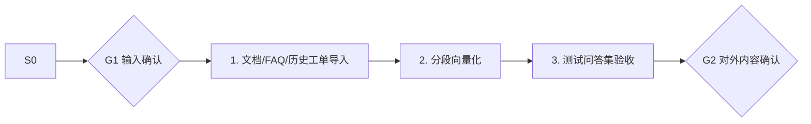

# 知识库构建 · 架构与流程图

## 本工作流的四层结构

| 层 | 内容 |
|---|---|
| 使用层 | 有付费用户、存在跨时区咨询的产品型开发者；员工定位：出海产品的"夜间值班员"：7×24 双语应答，高价值问题秒转人工 |
| 触发层 | 关键词 / 显式点名「知识库构建」；触发方式：人工（初次 + 月更） |
| 执行层 | 文档/FAQ/历史工单导入 → 分段向量化 → 测试问答集验收 |
| 产出层 | 测试问答集验收 |

## 执行流程

## 步骤职责表

| # | 步骤 | 承担者 | 为什么 |
|---|---|---|---|
| 1 | 文档/FAQ/历史工单导入 | 模型 | 需要读懂语境，不可用固定规则替代 |
| 2 | 分段向量化 | 模型 | 需要读懂语境，不可用固定规则替代 |
| 3 | 测试问答集验收 | 模型 | 需要读懂语境，不可用固定规则替代 |

⚠️ 尚未补齐：图中的步骤来自注册表口径，未逐条实跑校验；实跑后请同步修订本页（`发布标准.md` 第六项：通读一遍，不得出现重复填充句）。
